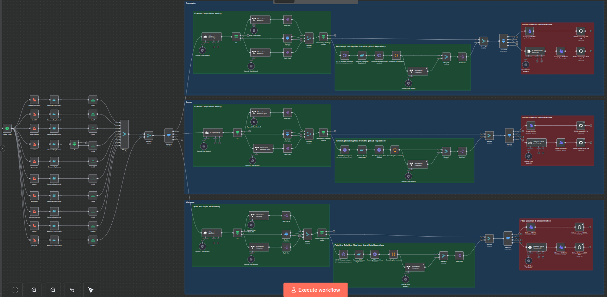

# AI threat intelligence directory: attack campaigns, threat groups and malware (n8n)

> A multi-agent **n8n** workflow that reads **10 threat research feeds** daily and **routes each article to specialist AI agents** for *attack campaigns*, *threat groups* and *malware*. The agents extract the named entity, write a profile with **IOCs**, filter out false positives, **check the existing GitHub knowledge base** to avoid duplicates, and commit new entries as **Markdown and JSON**. The result is an automatically growing, version-controlled threat intelligence directory.


---

## Blog posts

I wrote about this n8n automation work in more detail here:

- [How I Automated My Threat Intelligence Workflow with n8n (and What It Taught Me)](https://medium.com/meetcyber/how-i-automated-my-threat-intelligence-workflow-with-n8n-and-what-it-taught-me-f8c14aba6c72) on Medium (MeetCyber)
- [From Headlines to Slack: Automating Cyber Threat Intelligence Delivery](https://bloo.io/blog/from-headlines-to-slack-automating-cyber-threat-intelligence-delivery) on the Bloo blog (June 2025)

## Why I built this

Threat intel teams keep **directories of adversaries, campaigns and malware families**: who they are, how they operate, and which indicators link to them. Keeping these up to date from daily research output is slow, repetitive work. This POC automates the first draft:

1. **Classify** each article as campaign, threat group and/or malware (an article can be all three).
2. **Extract and profile** the named entity using a specialist AI agent per entity type.
3. **Normalise** names (`<NAME> CAMPAIGN`, `<NAME> GROUP`, `<NAME> MALWARE`) and **drop false positives** ("Unknown", "Unnamed", "KEV", …).
4. **Deduplicate against the knowledge base**: it reads the existing files from GitHub, extracts their source links with AI, and writes only **new** entities.
5. **Publish** each entity as `.md` (analyst-readable) and `.json` (machine-readable).

## Workflow canvas



On the left is shared ingestion (10 feeds → dedupe → limit → merge → classifier). On the right are three identical lanes, **Campaign**, **Group** and **Malware**. Each lane has an **Open AI Output Processing** block (green), a **Fetching Existing files from the GitHub Repository** block, and a **Files Creation & Dissemination** block (red).

## Architecture

```mermaid
flowchart LR
    T["Schedule Trigger<br/>daily 09:01"] --> DT["Date & Time"] --> F["10 RSS feeds"]
    F --> P["Remove Duplicates (title)<br/>Limit 3 per feed<br/>drop CISA ICS advisories"]
    P --> M["Merge + Merge4"]
    M --> SW{"Switch5: classifier<br/>regex on article text<br/>(all matching outputs)"}
    SW -- "campaign / operation" --> CA["Campaign lane"]
    SW -- "group / APT / threat actor" --> GA["Group lane"]
    SW -- "malware / ransomware / RAT / stealer" --> MA["Malware lane"]

    subgraph LANE["Each lane (example: Malware)"]
        direction LR
        AG["AI Agent Malware<br/>profile + IOCs"] --> IF{"If: blank /<br/>'not provided'?"}
        IF -- "no" --> IEN["Information Extractor<br/>Name"]
        IF -- "no" --> IER["Information Extractor<br/>Reference link"]
        IF -- "no" --> PASS["Switch: keep output"]
        IEN --> MG1["Merge1<br/>name + ref + profile"]
        IER --> MG1
        PASS --> MG1
        MG1 --> TG{"Terminating<br/>Garbage Values"}
        TG -- "valid" --> API["GitHub API:<br/>list malware/ folder"]
        API --> FETCH["Fetch file content<br/>+ base64 decode"]
        FETCH --> IEG["Information Extractor<br/>Reference link (existing file)"]
        TG -- "valid" --> CMP["Merge2: match<br/>GPT ref = GitHub ref"]
        IEG --> CMP
        CMP --> RT{"Switch10"}
        RT -- "New Malware" --> MD["MD file"] --> GH1["GitHub: commit .md"]
        RT -- "New Malware" --> JC["AI Agent<br/>JSON Converter"] --> GH2["GitHub: commit .json"]
        RT -- "Duplicate" --> DUP["held for content analysis"]
        RT -- "Extra on GitHub" --> EX["ignored"]
    end
    MA --> AG
```



---

## How each stage and node works

### 1. Ingestion (shared)

| Node(s) | Type | Role |
|---|---|---|
| **Schedule Trigger1** | `scheduleTrigger` | Runs daily at **09:01** (Asia/Kolkata). It supplies `Readable date` for commit messages. |
| **Date & Time1** | `dateTime` | Date reference (`Yesterday_Date`) |
| **TheHackersNews, Unit42, thedfirreport, cisa, specterops, elastic, securelist, talosintelligence, offsec, group-ib** | `rssFeedRead` ×10 | Curated threat research sources (see the table below) |
| **Remove Duplicates…** | `removeDuplicates` on `title` | Removes repeated items inside each feed |
| **Limit…** | `limit` = 3 | At most 3 articles per source per run, for balanced coverage and bounded LLM cost |
| **If** (CISA) | `if` regex | Drops **Industrial Control Systems** advisories (high volume, low directory value) |
| **Merge** (9 inputs) → **Merge4** | `merge` (append) | One article stream |
| **Switch5** | `switch`, regex on `content`, **all matching outputs** | **Classifier / router.** `campaign\|operation` goes to **Campaign**, `group\|apt\|threat actor` to **Group**, and `malware\|ransomware\|RAT\|stealer` to **Malware**. One article can feed several lanes. |

<details>
<summary><b>Feed sources</b></summary>

| Node | Feed |
|---|---|
| TheHackersNews | `feeds.feedburner.com/TheHackersNews` |
| Unit42 | `feeds.feedburner.com/Unit42` |
| thedfirreport | `thedfirreport.com/feed/` |
| cisa | `cisa.gov/cybersecurity-advisories/all.xml` |
| specterops | `specterops.io/blog/category/research/feed/` |
| elastic | `elastic.co/security-labs/rss/feed.xml` |
| securelist | `securelist.com/feed/` |
| talosintelligence | `blog.talosintelligence.com/rss/` |
| offsec | `offsec.blog/category/blog/feed/` |
| group-ib | `group-ib.com/feed/blogfeed/` |
</details>

### 2. Open AI output processing (per lane)

| Node (Campaign / Group / Malware) | Type | Role |
|---|---|---|
| **AI Agent Campaign / AI Agent Group / AI Agent Malware** | LangChain Agent + OpenAI Chat Model | **Specialist analyst agent.** It decides whether a named entity exists, then writes `## Name`, a 2×45-word `## Description`, `## IOC` and `## Reference`. |
| **If1 / If2 / If3** | `if` regex | Stops the item when the agent output is empty or says *"specific name not provided"* / *"No specific attack campaign named"* |
| **Information Extractor … Name** | `informationExtractor` + Chat Model | Pulls **just the entity name** out of the agent's Markdown as a structured attribute (`Name`) |
| **Information Extractor … Reference Link** | `informationExtractor` + Chat Model | Pulls the **source article URL** (`Reference`), which is the dedupe key |
| **Switch / Switch2 / Switch3** | `switch` | Passes on only non-empty agent outputs |
| **Split Out / Split Out1 / Split Out5** | `splitOut` → `Chatgptfilename` | The entity name becomes the file name |
| **Split Out12 / 13 / 14** | `splitOut` → `Reference_Link_GPTOutput` | Source link from today's analysis |
| **Merge5 / Merge3 / Merge1** | `merge`, combine by position (3 inputs) | Rebuilds one record: *name + reference + profile* |
| **Terminating Garbage Values (/2/3)** | `if`, OR of regex and empty checks | **False-positive filter.** Drops names such as `None`, `Unknown`, `Unnamed`, `Incident`, `Package(s)`, `KEV`, `Known Exploited Vulnerabilities`, `No …` and empty values |

### 3. Fetching existing files from the GitHub repository (per lane)

| Node | Type | Role |
|---|---|---|
| **HTTP Request campaign / group / malware** | GitHub REST `GET /repos/{org}/Threat-Intelligence-Hub/contents/threat-intelligence-hub/<lane>` | Lists the entity files already in the directory |
| **Remove Campaign / Group / Malware Duplicates** | `removeDuplicates` on `name` | One request per file |
| **Fetching … Files content** | `httpRequest` → `{{ $json.url }}` | Downloads each file (base64 content) |
| **Decoding the content (/1/2)** | `code` (JavaScript) | `Buffer.from(content, 'base64').toString('utf-8')` turns it back into readable Markdown |
| **Information Extractor Reference Link (campaign / group / malware)** | `informationExtractor` + Chat Model | Uses AI to extract the `References` URL from each existing file |
| **Merge16 / 17 / 18 → Split Out6 / 7 / 8** | `merge` + `splitOut` | Produces `Githubfilename`, `Githubfilecontent` and `Reference_Link_Github` |

### 4. Comparison, file creation and dissemination (per lane)

| Node | Type | Role |
|---|---|---|
| **Merge11 / Merge9 / Merge2** | `merge`, match `Reference_Link_GPTOutput` = `Reference_Link_Github`, keep everything | Full outer join of *today's findings* and *the existing directory* |
| **Switch13 / Switch9 / Switch10** | `switch` (3 named outputs) | **New Campaign / Group / Malware** (no GitHub match) is written. **Duplicate (for further content analysis)** (same source already stored) is held back. **Garbage files (extra on github)** (existing file not in today's batch) is ignored. |
| **Campaign / Group / Malware MD File** | `convertToFile` → text | `<NAME> CAMPAIGN.md` etc. |
| **AI Agent (JSON Converter) /1 /2** + Chat Model | Agent + `gpt-4o-mini` | Markdown profile converted to **JSON with UPPERCASE keys** |
| **Campaign / Group / Malware JSON File** | `convertToFile` → text | `<NAME> ….json` |
| **GitHub Campaign/group/malware MD File, GitHub … JSON File** | `github` → create file | Commits to `threat-intelligence-hub/<campaign\|group\|malware>/<NAME>.md\|.json` |

---

## How the AI agents are built

The workflow contains **15 LLM-powered nodes**, each wired to its own **OpenAI Chat Model** sub-node (`gpt-4o-mini`) through n8n's `ai_languageModel` connection:

```text
           ┌─────────────── Specialist agent (Campaign | Group | Malware) ───────────────┐
article ──►│ system: definition of the entity (Wikipedia / Cisco), IoC taxonomy,         │──► Markdown profile
           │ "ensure minimal false positive generation", strict output format,           │
           │ naming rule: ALL CAPS, singular, suffix CAMPAIGN | GROUP | MALWARE          │
           └──────────────────────────────────────────────────────────────────────────────┘
                     │                               │
                     ▼                               ▼
     Information Extractor: Name      Information Extractor: Reference  ──► dedupe key
```

**Prompt engineering techniques used:**

- **Grounding definitions.** Each agent gets a definition of its entity type (malware from Wikipedia and Cisco; threat actor and campaign definitions) and an **IoC taxonomy** (network, host, file, behavioural). This anchors the classification and reduces confusion between, for example, a malware family and the group that uses it.
- **Abstention.** *"If no malware is named, give a blank output."* The agent is allowed to say nothing, which is the main defence against invented entities.
- **No generic IOCs.** *"If no specific IP address, domain name, malware hash or suspicious filename is found, write 'No IOC found'."*
- **Deterministic naming.** ALL CAPS, singular, with a type suffix, so the same entity always maps to the same file name across runs.
- **Layered validation.** Agent abstention, then If-node phrase checks, then the garbage-name regex, then the knowledge base dedupe. There are four gates before anything is committed.

<details>
<summary><b>System prompt: AI Agent Malware (abridged)</b></summary>

```text
You have to extract the name of the malware mentioned in this article; a malware might be
present, it also might not. If present, infer how the malware functions and summarise it.
[Definitions of malware (Wikipedia, Cisco) and of IoC types a–d]
Note: Threat actors are not the same as malware … Ensure minimal false positive generation.

Expected Output: name of malware, 2×45-word paragraphs, specific IOCs.
IMPORTANT: if no malware is named, give a blank output. Do not give generic IoCs; if none are
found write "No IOC found".
Format:
## Name: <NAME> MALWARE
## Description:
## IOC:
## Reference: {{ $json.link }}
Naming: ends with "MALWARE", singular, ALL CAPS.
```
The **Group** and **Campaign** agents follow the same template, using threat actor and attack campaign definitions and the `GROUP` / `CAMPAIGN` suffixes.
</details>

---

## Output: directory layout

```text
Threat-Intelligence-Hub/
└── threat-intelligence-hub/
    ├── campaign/
    │   ├── <NAME> CAMPAIGN.md
    │   └── <NAME> CAMPAIGN.json
    ├── group/
    │   ├── <NAME> GROUP.md
    │   └── <NAME> GROUP.json
    └── malware/
        ├── <NAME> MALWARE.md
        └── <NAME> MALWARE.json
```

Example entity file (`.md`):

```markdown
## Name: <NAME> MALWARE
## Description:
<45-word paragraph: what it is, delivery, targets>
<45-word paragraph: capabilities, persistence, C2, impact>
## IOC:
<specific IPs / domains / hashes / file names>  |  No IOC found
## Reference:
https://…
```

---

## Setup

1. **Import** `workflow/threat-intel-directory-campaigns-groups-malware.json` into n8n.
2. **Create the knowledge base repo** (for example `Threat-Intelligence-Hub`) with the folders `threat-intelligence-hub/campaign`, `…/group` and `…/malware`. Add a placeholder file to each, because the GitHub API returns 404 for missing folders.
3. **Credentials:**
   - **OpenAI API** on all 15 *OpenAI Chat Model* nodes.
   - **GitHub API** (fine-grained token, **Contents: read and write**, scoped to the one repo) on the six *GitHub … File* nodes.
   - **HTTP Request nodes:** replace the `Authorization: Bearer <GITHUB-TOKEN-HERE>` header, or better, switch the node to *Predefined credential type → GitHub API*.
4. **Replace placeholders:** `YOUR_GITHUB_ORG`, the repo name (if different) and `REPLACE_WITH_YOUR_CREDENTIAL_ID`.
5. Run it once with **Execute workflow** and review the first entities, then set it to **Active**.

## Related Blogs by Author

- https://medium.com/meetcyber/how-i-automated-my-threat-intelligence-workflow-with-n8n-and-what-it-taught-me-f8c14aba6c72
- https://bloo.io/blog/from-headlines-to-slack-automating-cyber-threat-intelligence-delivery

## Related projects

- [n8n-ai-cyber-news-briefing](https://github.com/Shailendra7727/n8n-ai-cyber-news-briefing): daily cyber news briefs to Slack and Gmail
- [n8n-ai-threat-intel-daily-briefing](https://github.com/Shailendra7727/n8n-ai-threat-intel-daily-briefing): Daily Briefing and Content Update knowledge base on GitHub

## License

[MIT](LICENSE). This is a proof of concept for portfolio and educational use.
